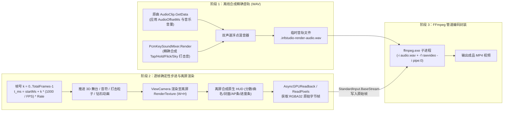

# InFalsus Studio+ 制谱器内置视频渲染（FFmpeg）技术方案

本文档基于开发仓库 `E:\RhythmGame\InFalsusStudio+` 现有 UI 框架、音频混音管线与 URP 渲染管线拟定，详细说明如何将**视频渲染**入口放置在**左边栏最后一个位置**，并通过 **FFmpeg 管道 + 离线确定性步进（Offline Deterministic Stepping）** 实现不掉帧、音画严格同步的内置谱面预览视频导出。

---

## 一、 左边栏入口布局与面板挂载设计（左边栏最后一个）

### 1. 左边栏（Left Rail）现状与第 9 格落位
在 `studio_icon_work/Source/UI/NativeEditorUIDocked.cs` 的 `DrawDockedRails()` 中，左边栏（`leftRect`）自上而下现有 4 组共 8 个图标按钮：
1. `point`（点立得）
2. `range`（段落选择）
   *— 分割线 —*
3. `copy`（复制与批量编辑 -> 面板 `"编辑"`）
4. `autoplay`（自动播放开关）
   *— 分割线 —*
5. `grid`（网格与吸附 -> 面板 `"网格"`）
6. `air`（放置默认值 -> 面板 `"放置"`）
   *— 分割线 —*
7. `wave`（音频波形 -> 面板 `"波形"`）
8. `check`（谱面检查 -> 面板 `"检查"`）

**新增第 9 个按钮（左边栏最后一个）**：
- 在 `check`（谱面检查）正下方追加：
  ```csharp
  y += railCell * scale;
  RailButton(leftRect, y, "render", "视频渲染", "渲染");
  ```
- **高度自适应防溢出（`LayoutDocked`）**：
  - 在 `2560×1351` 基准分辨率下，`leftRect` 可用高度在隐藏波形时为 `1054`，显示底部详细波形（`WaveVisible == true`）时为 `848`。
  - 9 个按钮 + 3 处分组间距（`3 × 20 = 60`）：当 `railCell = 80` 时总高 `9 × 80 + 60 = 780 <= 848`，在标准 16:9 窗口下可直接容纳。
  - 为防止超宽屏窗口（如 21:9）纵向空间不足导致最后一个按钮越界，在 `LayoutDocked()` 中将单元格高度改为动态上限：
    ```csharp
    float maxCell = Mathf.Floor((leftRect.height / scale - 60f) / 9f);
    railCell = Mathf.Clamp(WaveVisible ? 80f : 96f, 48f, maxCell);
    ```
- **图标绘制（`Icon("render")`）**：
  - 支持读取外部 `Icons/render.png`；同时在 `NativeEditorUIDocked.cs` 的 `Icon(string key)` `switch` 中内置矢量绘制分支 `case "render":`（绘制摄影机/胶片外框 + 中心导出播放三角，与现有左边栏线条风格完全一致）。

### 2. 左边栏抽屉面板停靠与路由
1. **左停靠判定（`NativeEditorUIDocked.cs` -> `LayoutDocked`）**：
   - 将 `"渲染"` 加入左侧弹出面板集合：
     ```csharp
     bool left = panel=="编辑" || panel=="网格" || panel=="放置" || panel=="波形" || panel=="检查" || panel=="渲染" || panel=="选取过滤" || panel=="段落过滤";
     ```
   - 点击左边栏最后一个 `"渲染"` 图标时，抽屉面板紧贴左边栏右侧（`x = 104 * scale`）展开，再点一次或点面板右上角 `×` 收起。
2. **面板标题与内容路由（`NativeEditorUIMatched.cs`）**：
   - 在 `DrawMatchedPanelContent()` 的 `title` 映射中新增：`panel == "渲染" ? "视频渲染" : ...`
   - 在内容分发分支中新增：`else if (panel == "渲染") MatchedRender();`
   - 在 `MatchedContentHeight()` 中返回 `renderContentHeight` 以支持平滑滚动。

---

## 二、 核心实现原理：为什么不用实时录屏，而用“离线确定性帧步进 + FFmpeg 管道”

如果采用“边实时播放谱面边截屏”的传统录屏方式，一旦电脑后台卡顿、GC 触发或高分辨率（如 4K 60/120fps）下 GPU 帧率不足，导出的视频就会出现**掉帧、音画不同步、打击特效错位、音频爆音**。

因此，本方案采用专业音游渲染器的 **离线确定性步进架构（Offline Deterministic Frame Stepping + Pre-mixed Audio + FFmpeg Pipe）**：



### 原理优势
1. **绝对不掉帧**：无论导出 `1080p 60fps` 还是 `4K 120fps`，哪怕单帧渲染耗时 50ms，第 $k$ 帧也永远精确对应谱面时间 $t_k = t_{\text{start}} + \frac{k}{\text{FPS}} \times 1000 \times \text{Rate}$，导出视频丝滑稳定。
2. **窗口大小无关**：通过离屏 `RenderTexture(targetWidth, targetHeight)` 渲染，即使制谱器窗口处于小窗口模式，也能直接导出标准 `1920×1080`、`2560×1440` 或 `3840×2160` 视频。
3. **纯净画面（不含编辑器边栏）**：离屏渲染只采集 `ViewCamera`（3D 舞台、轨道、音符、按键字、打击特效、连击数字）与可选的原生游戏 HUD（分数、曲目信息、进度条），制谱器的左右边栏、底栏和渲染进度弹窗完全不会录进视频中。
4. **打击音与原曲零延迟对齐**：直接复用项目现有的 `PcmKeySoundMixer`（`upstream/Assets/InFalsusStudio/Runtime/Core/PcmKeySoundMixer.cs`）与 `AudioClip.GetData`（`OffsetAudioExport.cs`），在内存中按采样点级别把音乐与打击音合成为精确音轨交给 FFmpeg。

---

## 三、 渲染界面示意图与参数设置说明（`MatchedRender`）

以下为紧贴左边栏展开的 **`视频渲染` 抽屉面板（`panel == "渲染"`）** 与 **渲染中遮罩弹窗** 的布局结构示意图，严格遵循 `NativeEditorUIMatched.cs` 的 `460px` 面板规范（`ContentRow`、`MatchedSection`、`MatchedField`、`MatchedToggle`、`FlatButton`）：

```text
┌──────────┬───────────────────────────────────────────────┬──────────────────────────────────────────┐
│ 左边栏    │ 视频渲染 (MatchedRender 抽屉面板, 宽 460*scale) │               3D 舞台预览区               │
│(leftRect)│                                           [×] │                                          │
├──────────┼───────────────────────────────────────────────┤  ┌────────────────────────────────────┐  │
│ 1. 点立得 │ ── 渲染范围与时间 (MatchedSection) ────────── │  │ [渲染进行态遮罩弹窗 (仅在渲染时显示)] │  │
│ 2. 段落   │ 时间范围       [ 全曲 ] [ 循环段 ] [ 自定义 ] │  │ 正在渲染视频 (1080p · 60 FPS)       │  │
│ ──────── │ 开始时间 (ms)            [      0 ] ms [当前] │  │ ────────────────────────────────── │  │
│ 3. 编辑   │ 结束时间 (ms)            [ 142500 ] ms [当前] │  │ 阶段：2/2 离屏帧渲染与 FFmpeg 写入  │  │
│ 4. 自动   │                                               │  │ 帧进度：2,850 / 8,550 帧 (33.3%)   │  │
│ ──────── │ ── 视频规格与编码 (MatchedSection) ────────── │  │ 谱面时间：47,500 / 142,500 ms      │  │
│ 5. 网格   │ 分辨率     [ 720p ] [1080p*] [1440p] [ 4K ]   │  │ 速率/剩余：94.2 fps · 约 01:00     │  │
│ 6. 放置   │ 帧率 (FPS)           [ 30 ]  [ 60* ]  [ 120 ] │  │ [██████████░░░░░░░░░░░░░░░░░░░░]   │  │
│ ──────── │ 视频编码器  [H.264(CPU)*] [NVENC(N卡)] [HEVC] │  │                                    │  │
│ 7. 波形   │ 画质系数 (CRF)                  CRF 18 (无损) │  │ 按 Esc 可中止      [ 取消渲染(Esc) ] │  │
│ 8. 检查   │ ├──────────────●────────────────────────────┤ │  └────────────────────────────────────┘  │
│ ┏━━━━━━┓ │                                               │                                          │
│ ┃9.渲染┃◀┼─ 左边栏最后一个按钮 (Icon: "render")          │                                          │
│ ┃ (激活)┃ │ ── 画面元素与混音 (MatchedSection) ────────── │                                          │
│ ┗━━━━━━┛ │ 显示游戏 HUD (分数/曲名/进度条)        [■ ON] │                                          │
│          │ 包含打击音效 (离线合成 KeySounds)      [■ ON] │                                          │
│          │ 首尾黑场淡入淡出 (0.5 秒)              [■ ON] │                                          │
│          │                                               │                                          │
│          │ ── FFmpeg 环境与导出 (MatchedSection) ─────── │                                          │
│          │ ✓ 已就绪：Tools/ffmpeg.exe       [ 指定路径 ] │                                          │
│          │ ┌──────────────────────────┐ ┌──────────────┐ │                                          │
│          │ │       开始渲染视频       │ │  打开文件夹  │ │                                          │
│          │ └──────────────────────────┘ └──────────────┘ │                                          │
│          │ 输出：Render/Song_ULT_1080p_60fps.mp4         │                                          │
├──────────┴───────────────────────────────────────────────┴──────────────────────────────────────────┤
│ [▶ 正式播放]  [↶] [↷] [💾]  |  基准 BPM: 180  |  音频偏移: 0 ms  |  当前时间: 47500 ms  |  视速: 4.5 │
└─────────────────────────────────────────────────────────────────────────────────────────────────────┘
```

### 面板各项参数对照与控件映射表

| 分组 | 参数名称 | UI 控件类型 (`NativeEditorUIMatched`) | 可选值 / 范围 | 默认值 | 映射到 FFmpeg / 渲染器的作用 |
| :--- | :--- | :--- | :--- | :--- | :--- |
| **渲染范围与时间** | `时间范围` | 3 按钮单选行 (`FlatButton` ×3) | `全曲` / `循环段` / `自定义` | `全曲` | 决定渲染起止时间 `[startMs, endMs]` |
| | `开始时间` / `结束时间` | `MatchedField` + `[当前]` 按钮 | `0 ~ durationMs` (ms) | `0 ~ 谱面末尾` | 仅在 `自定义` 模式下可手动输入，或一键取 `Transport.TimeMs` |
| **视频规格与编码** | `分辨率` | 4 按钮单选行 (`FlatButton` ×4) | `720p` / `1080p` / `1440p` / `4K` | `1080p (1920×1080)` | 设置离屏 `RenderTexture(W, H)` 与 FFmpeg `-s WxH` |
| | `帧率 (FPS)` | 3 按钮单选行 (`FlatButton` ×3) | `30` / `60` / `120` | `60` | 设置步进间隔 $\Delta t = 1000/\text{FPS}$ 与 FFmpeg `-r FPS` |
| | `视频编码器` | 3 按钮单选行 (`FlatButton` ×3) | `H.264 (libx264)` / `NVENC (h264_nvenc)` / `HEVC` | `H.264 (libx264)` | 设置 FFmpeg `-c:v` 编码器与 `-preset` 参数 |
| | `画质系数 (CRF)` | `MatchedSlider` (`12 ~ 28`) | `12`（极高）~ `28`（小体积） | `CRF 18`（视觉无损） | 设置 FFmpeg `-crf`（或 NVENC `-cq`）画质参数 |
| **画面元素与混音** | `显示游戏 HUD` | `MatchedToggle` | `开` / `关` | `开` | 是否在离屏 `RenderTexture` 上叠加绘制原生分数、曲名、封面、进度条 |
| | `包含打击音效` | `MatchedToggle` | `开` / `关` | `开` | 是否在离线 WAV 合成时混入 `PcmKeySoundMixer` 的 Tap/Hold/Flick/Sky 打击音 |
| | `首尾黑场淡入淡出` | `MatchedToggle` | `开` / `关` | `开` | 首尾 0.5 秒画面与音频平滑淡入淡出 |
| **FFmpeg 与导出** | `FFmpeg 状态与路径` | 状态文本 + `FlatButton("指定路径")` | 自动探测 `Tools/ffmpeg.exe` / `PATH` / 手动选择 | 自动探测 | 定位 `ffmpeg.exe` 可执行文件 |
| | `开始渲染` / `打开文件夹` | 底部主操作双按钮 (`FlatButton`) | 点击启动渲染协程 / 打开 `Render/` 目录 | — | 渲染进行中按钮变为 `取消渲染 (Esc)` |

---

## 四、 详细实现逻辑与关键技术细节

### 1. 阶段一：离线合成精确音轨（`OfflineAudioRender.cs`）
在启动视频帧循环前，先花 0.5~1 秒生成与视频时间区间 $[t_{\text{start}}, t_{\text{end}}]$ 完全对齐的临时 WAV 文件：
1. **参数计算**：
   - 采样率 $F_s = \text{clip.frequency}$（通常为 `44100` 或 `48000` Hz），声道数 $C = 2$（立体声）。
   - 视频总时长（秒）：$D_{\text{sec}} = \frac{t_{\text{end}} - t_{\text{start}}}{1000.0 \times \text{Rate}}$。
   - 总音频采样帧数：$N_{\text{samples}} = \text{ round }(D_{\text{sec}} \times F_s)$。
2. **原曲采样读取**：
   - 根据谱面时间 $t$ 与音频偏移 $\text{AudioOffsetMs}$ 的关系（$\text{audioMs} = t + \text{AudioOffsetMs}$），计算原曲 `AudioClip` 的起始采样偏移。
   - 分块（每次 `16384` 帧）调用 `AudioClip.GetData` 读取原曲波形，若 $\text{Rate} == 1.0$ 直接按 `Transport.Volume` 乘算写入混音缓冲；若 $\text{Rate} \neq 1.0$ 进行线性插值重采样。
3. **打击音效（KeySounds）离线混音**：
   - 若开启“包含打击音效”，直接实例化一个独立的 `PcmKeySoundMixer`，构造 `PcmMixState`（将 `OriginMs` 设为 $t_{\text{start}}$，`OriginDsp` 设为 `0.0`，传入当前的 `PcmSoundPlan` 及 `MasterVolume`、`ShotVolume`、`HoldVolume`）。
   - 对每个音频分块调用 `mixer.Render(fxBuffer, 2, sampleRate, blockDspStart, mixState)`，将 `fxBuffer` 叠加到原曲缓冲上，并进行 `[-1.0, 1.0]` 软限幅防爆音（复用 `OffsetAudioExport.WriteWaveHeader` 写入 16-bit PCM `.wav` 临时文件）。

### 2. 阶段二：离屏相机与原生 HUD 合成管线（`OfflineFrameCapture.cs`）
这是保证**画面与制谱器正式播放 100% 一致**的核心环节：

#### (1) 状态锁定与步进时钟接管
- 进入渲染时：
  - 暂停实时 `AudioTransport`；记录进入前的 `entryTimeMs`、`selectedId`、`selection`、`formal` 等状态。
  - 将 `formal` 设为 `true`（隐藏所有编辑辅助线、节拍网格线与选中框，启用正式预览视图）。
  - 接管 `StudioBootstrap.CurrentMs`、`Transport.TimeMs` 与 `PlaybackPresentationClock`：在渲染第 $k$ 帧时，令固定帧间隔 $\Delta t = \frac{1.0}{\text{FPS}}$，当前谱面时间：
    $$t_k = t_{\text{start}} + k \times \frac{1000.0}{\text{FPS}} \times \text{Rate}$$
- **粒子与动态背景确定性推进**：
  - `NativeVisualHitEffects`（打击粒子）、`NativeCenter`（中心六边形钻石动态扩散）若依赖时间增量，在渲染模式下统一读取虚拟帧时间 `renderElapsedSec = k / (double)FPS`，确保在任意渲染速度下粒子运动速度与实机完全一致。

#### (2) 3D 舞台离屏渲染（兼容 URP RenderGraph 与 `NativeKeyLabels`）
- 创建目标分辨率的 `RenderTexture`：
  ```csharp
  var desc = new RenderTextureDescriptor(targetWidth, targetHeight, RenderTextureFormat.ARGB32, 24) {
      msaaSamples = AntialiasingSettings.CurrentMsaaSamples,
      sRGB = QualitySettings.activeColorSpace == ColorSpace.Linear
  };
  var targetRt = new RenderTexture(desc);
  ```
- 在每帧步进中：
  1. 调用 `StudioBootstrap` 的几何与物件更新：更新 `cursorPose = cursorMotion.Evaluate(t_k)`、`notes.Draw(...)`、`hitFeedback.Draw(...)`、`floorCombo.Draw(...)`。
  2. 将 `ViewCamera.targetTexture = targetRt`，临时将 `ViewCamera.rect = new Rect(0, 0, 1, 1)`，调用 `StageSpace.ApplyCamera(ViewCamera, Profile)` 以匹配 16:9 目标分辨率长宽比。
  3. 调用 `ViewCamera.Render()`：此时 URP 管线自动执行场景渲染以及挂载在 `RenderPipelineManager.beginCameraRendering` 上的 `NativeKeyLabels`（轨道 Shift/A/S/D/F/Space 标识）与 `NativeVisual` 全部 Pass。
  4. 渲染完毕后立即恢复 `ViewCamera.targetTexture = null`，避免影响主窗口显示。

#### (3) 原生 HUD 离屏合成（`RenderHudToTexture`）
- 由于制谱器中的原生计分板（`ScoreContainer`）、曲目信息框（`SongInfoContainer`）、封面（`Jacket`）、顶部 AP 指示器（`clearstate-ap`）和顶部进度条是在 `NativeVisualPresentation.cs` 中通过 `GUI.DrawTexture` 绘制的，单纯调用 `ViewCamera.Render()` 不会包含它们。
- **离屏合成方案**：
  - 若开启“显示游戏 HUD”，在 `ViewCamera.Render()` 完成后，在 `OnGUI` 的 `EventType.Repaint` 阶段（或通过 `RenderTexture.active = targetRt` + `GL.PushMatrix()` + `GL.LoadPixelMatrix(0, targetWidth, targetHeight, 0)`）：
  - 将 `NativePresentation.Layout` 的视口基准临时指向 `new Rect(0, 0, targetWidth, targetHeight)`，`hudScale = targetWidth / 1920f`；
  - 直接在 `targetRt` 上调用 `NativePresentation` 的 HUD 绘制方法（绘制分数、曲名、曲师、难度框、封面、AP 指示条与进度条）；
  - 恢复 `RenderTexture.active` 与主窗口 `hudScale`。这样无论主窗口多大，导出的视频里都有 1:1 清晰对齐的原生 HUD，且**绝不会把渲染进度条或鼠标指针录进去**。

### 3. 阶段三：FFmpeg 命令行构建与双缓冲管道写入（`FFmpegPipeEncoder.cs`）

#### (1) FFmpeg 启动参数设计
通过 `System.Diagnostics.Process` 启动 `ffmpeg.exe`（`UseShellExecute = false`，`CreateNoWindow = true`，`RedirectStandardInput = true`，`RedirectStandardError = true`）：

```text
ffmpeg -y -hide_banner -loglevel warning
  -f rawvideo -vcodec rawvideo -pix_fmt rgba -s {W}x{H} -r {FPS} -i pipe:0
  -i "{tempAudioWavPath}"
  -map 0:v:0 -map 1:a:0
  -vf "vflip,format=yuv420p"
  -c:v {libx264 / h264_nvenc} -preset {medium / p5} -crf {18}
  -c:a aac -b:a 320k
  -movflags +faststart
  "{outputMp4Path}"
```
> **关键细节说明**：
> - **`-vf "vflip,format=yuv420p"`**：Unity 在 Direct3D 11 下从 `RenderTexture` 读取的像素行序是自下而上的（Bottom-to-Top）。无需在 C# CPU 端耗费算力逐行翻转数组，直接交给 FFmpeg 的 `vflip` 滤镜零成本翻转并转为播放器通用的 `yuv420p`。
> - **异步日志读取**：后台线程持续消费 `StandardError`，既防止管道缓冲区满导致死锁，又能提取 FFmpeg 报错信息；所有路径参数严格使用引号转义校验（复用 `NativeExternalToolRunner` 的安全规范）。

#### (2) 异步 GPU 回读与后台写入队列
为避免主线程在 `ReadPixels` 和磁盘管道 I/O 上阻塞导致界面无响应：
1. **GPU -> CPU 回读**：优先使用 `UnityEngine.Rendering.AsyncGPUReadback.Request(resolveRt, 0, TextureFormat.RGBA32, OnFrameReadback)`（若旧显卡不支持则自动回退到复用的 `Texture2D.ReadPixels` + `GetRawTextureData<byte>()`）。
2. **有界环形字节池（Bounded Byte Pool）**：预分配 4 个大小为 `W × H × 4` 的 `byte[]` 缓冲块，主线程回读填入队列，独立后台写入线程从队列取出并调用 `ffmpegStdin.Write(buffer, 0, buffer.Length)`，实现 **0 GC 分配**（不会触发内存暴涨或 OOM）。
3. **主窗口进度展示与随时取消**：
   - 每帧协程（`IEnumerator`）推进 1~2 帧后 `yield return null`，保持制谱器窗口响应；
   - 在屏幕中央绘制半透明渲染遮罩面板，展示当前预览画面缩略、进度百分比、已用时间、预计剩余时间，以及醒目的 **`取消渲染 (Esc)`** 按钮。
   - 若用户点击取消或按 `Esc`：立即关闭 `stdin`、终止 `ffmpeg` 进程、清理 `.tmp.wav` 与未完成的 `.tmp.mp4`，并将 `Transport` 恢复到渲染前的编辑状态。

---

## 五、 涉及修改与新增的代码文件清单

| 文件路径 | 改动类型 | 职责说明 |
| :--- | :--- | :--- |
| `studio_icon_work/Source/UI/NativeEditorUIDocked.cs` | 修改 | 1. 在 `DrawDockedRails()` 左边栏末尾新增 `"render"`（视频渲染）按钮；<br/>2. 在 `LayoutDocked()` 将 `"渲染"` 加入左侧面板停靠列表并做 `railCell` 高度自适应；<br/>3. 在 `Icon()` 新增 `"render"` 图标绘制 |
| `studio_icon_work/Source/UI/NativeEditorUIMatched.cs` | 修改 | 在 `DrawMatchedPanelContent()` 和 `MatchedContentHeight()` 中接入 `"渲染"` 面板（`MatchedRender()`） |
| `studio_icon_work/Source/UI/NativeEditorUIPlugin.cs` | 修改 | 在 `InitializeEngine()`、`Update()`、`OnDestroy()` 中接入渲染器生命周期与 `Esc` 取消热键；渲染期间屏蔽常规编辑操作 |
| `studio_icon_work/Source/Render/VideoRenderPreferences.cs` | 新增 | 渲染配置项（分辨率、帧率、编码器、CRF、HUD/打击音开关、FFmpeg 路径）及 `settings.cfg` 持久化 |
| `studio_icon_work/Source/Render/VideoRenderPanel.cs` | 新增 | 左边栏 `"视频渲染"` 抽屉面板 UI（`MatchedRender`）及渲染进行中的进度遮罩层绘制 |
| `studio_icon_work/Source/Render/OfflineAudioSynthesizer.cs` | 新增 | 基于 `AudioClip.GetData` + `PcmKeySoundMixer.Render` 的离线精确立体声 WAV 合成器 |
| `studio_icon_work/Source/Render/OfflineFrameStepper.cs` | 新增 | 确定性时钟步进、离屏 `RenderTexture` 3D 渲染与原生 HUD 离屏合成、GPU 字节回读 |
| `studio_icon_work/Source/Render/FFmpegPipeProcess.cs` | 新增 | FFmpeg 可执行文件探测、命令行构建、环形缓冲池管道写入、异常恢复与临时文件清理 |
