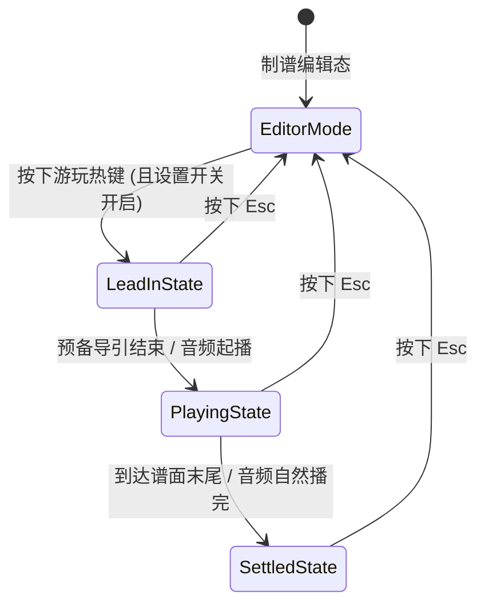

# InFalsus Studio+ 制谱器内置游玩模式（Built-in Gameplay Mode）技术方案

本文档基于开发仓库 `E:\RhythmGame\InFalsusStudio+` 与本体逆向研究资料库 `E:\RhythmGame\InFalsus\inffanmade\谱面研究资料` 拟定，详细说明制谱器内置游玩模式的实现原理、本体判定细节逻辑、设置开关与热键交互、音画特效接管及代码改造落点。

---

## 一、 本体判定资料核查与缺失项说明

在 `E:\RhythmGame\InFalsus\inffanmade\谱面研究资料` 中，**已找到完整反汇编验证的本体核心判定算法与数值**，同时也存在**部分未提取的视觉/外围资料**。边界说明如下：

### 1. 已找到并可 1:1 还原的本体判定资料
均来自 `In Falsus` 本体 `GameAssembly.dll`（1.0.5 / 1.0.10 / 1.07b 交叉验证）：
- **判定等级枚举与窗口**：`E:\RhythmGame\InFalsus\inffanmade\谱面研究资料\infalsus判定逻辑.md`
- **物量（Ticks）拆分规则**：`分析资料\native_ticks.asm.txt`（`LogicalNotePlayer._pb`, RVA `0x52aee0`）
- **地面 Tap / Hold 头判与 Tick 判定**：`分析资料\native_ground_judge.asm.txt`（`_VD._pz`, RVA `0x5f61b0`）与 `_VD._Uz`（RVA `0x5f5400`）
- **Flick 滑动窗口与方向判定**：`分析资料\native_flick_judge.asm.txt`（`_VD._nz`, RVA `0x5f5cc0` 及滑动历史跟踪器 `_TD`, RVA `0x5f1c20`）
- **SkyArea 容量池/冷却/捕获/跨组重置状态机**：`skyarea判定.md` 与 `分析资料\native_manual_loop.asm.txt`（`_VD._Oz`, RVA `0x5f2840`）
- **分数、Combo、血条/Gauge、Clear 与评级计算**：
  - `分析资料\native_score_process.asm.txt`（`_Uh._pMA`, RVA `0x4b0b80`）
  - `分析资料\native_grade_counter.asm.txt`（`_VD._Nz`, RVA `0x5f2690`）
  - `分析资料\native_final_clear.asm.txt`（`GameResultV4.CalculateClear`, RVA `0x49fef0`）
  - `分析资料\native_rank.asm.txt`（`GameResultV4.CalculatedRank`, RVA `0x4a0010`）

### 2. 未找到具体本体资料的部分（跳过或采用制谱器原生替代）
1. **轨道浮动判定文字（`Exact+` / `Exact` / `Near` / `Break` 及 `EARLY / LATE` 弹窗贴图与动画曲线）**：
   - 反汇编中仅见 `_VD._Oz` 调用 `Track._dBA`（RVA `0x672e30`）在音符位置生成判定等级弹窗，但现有资料库及 `Assets/native-presentation.bin`、`Effects/native-effects.bin` 中**未提取该浮动文字的贴图、字体材质与上浮渐隐动画参数**。
   - **处理方式**：跳过本体 3D 轨道浮动判定文字资产还原，改用制谱器 HUD 实时显示当前判定等级与 Early/Late 毫秒偏移。
2. **角色专属技能对血条（Gauge）与判定的修正系数**：
   - 本体不同角色（Nia / Mei / Iris / Ayame / Story）在打歌时的特殊技能修正未在谱面研究资料中逆向。
   - **处理方式**：仅使用本体基础分值与计数规则，不模拟角色技能血条死锁（Fail 强退），确保制谱测试可以完整打完。
3. **本体地面侧轨（Lane 0 与 Lane 5）双键混用设置项（`r14+0x68`）及自定义键位表**：
   - 在 `native_ground_judge.asm.txt` 中，本体通过配置项决定侧轨 0 和 5 是“左 Shift 对应 0、Space 对应 5”还是“Shift/Space 两侧互通”。资料中未记录该设置面板的默认细则。
   - **处理方式**：默认严格对应制谱器轨道标识（轨道 `0..5` 对应 `LeftShift`、`A`、`S`、`D`、`F`、`Space`，轨道 0 同时兼容 `RightShift`）。

---

## 二、 设置开关、热键与 `Esc` 退出交互设计

### 1. 设置面板内置开关（Settings Toggle）
- **UI 挂载位置**：在 `studio_icon_work/Source/UI/NativeEditorUIMatched.cs` 的 `MatchedSettings()` 以及 `studio_icon_work/Source/UI/NativeEditorUIPanels.cs` 的 `Settings()` -> `操作` 分组（紧随 `"长按空格预览"` 下方）新增开关：
  - 名称：`内置游玩模式`（配置键名：`enableGameplayMode`）
  - 说明：`允许通过游玩热键从当前时间点进入实机判定游玩，按 Esc 退出。`
- **持久化存储**：
  - 在 `studio_icon_work/Source/UI/OperationPreferences.cs` 的 `OperationState` 中新增字段 `public bool enableGameplayMode = true;`。
  - 在 `Apply()`、`ReadKey()`、`AppendLines()` 中接入 `%APPDATA%/infstudio/settings.cfg` 读写。
  - 当该开关为**关闭**状态时，按下游玩热键不响应；若在游玩途中通过外部方式关闭开关，立即强制退出游玩模式。

### 2. 游玩模式热键注册（Configurable Hotkey）
- **热键定义**：在 `studio_icon_work/Source/UI/StudioHotkeys.cs` 的 `Actions` 数组中，`播放与视图` 分类下新增动作：
  ```csharp
  new HotkeyAction("gameplayStart", "内置游玩（Esc 退出）", "播放与视图", new HotkeyChord(KeyCode.P))
  ```
  - 当前默认热键表中 `P` 键未被占用（`Space` 为 `previewHold`，`Q` 为 `previewToggle`），用户可在 `设置 -> 操作 -> 热键` 面板中自由改绑（如改为 `F5` 或 `Ctrl+P`）。
- **热键路由**：在 `studio_icon_work/Source/UI/HotkeySettings.cs` 的 `ExecuteCustomAction` 中处理 `"gameplayStart"`：
  - 若 `OperationPreferences.EnableGameplayMode` 为 `true` 且当前未处于游玩模式，则调用 `GameplaySession.Enter(boot)` 进入内置游玩。

### 3. `Esc` 退出与游玩期间的热键屏蔽机制（防冲突核心）
游玩过程中玩家高频敲击 `LeftShift`、`A`、`S`、`D`、`F`、`Space` 并大幅移动鼠标，必须隔离编辑器原有的热键与鼠标编辑行为：
- **输入拦截点 1（`OnGUI` 快捷键拦截）**：在 `studio_icon_work/Source/UI/NativeEditorUIPlugin.cs` 的 `BeforeKeys` 前缀补丁及 `HotkeySettings.RouteHotkey` 入口：
  - 当 `GameplaySession.Active == true` 时：
    1. 检测 `Event.current.type == EventType.KeyDown && Event.current.keyCode == KeyCode.Escape`：立即调用 `GameplaySession.Exit(boot)`，消费事件 `Event.current.Use()`，并跳过原方法。
    2. 对于除 `Escape` 以外的所有键盘事件（`KeyDown` / `KeyUp`），在 `BeforeKeys` 中直接拦截（返回 `false` 跳过 `StudioBootstrap.HandleShortcuts` 与 `HoldSpacePreview.SpaceKey`），防止 `Space` 触发暂停或 `A/S/D/F` 触发制谱快捷键。
- **输入拦截点 2（3D 舞台鼠标交互拦截）**：
  - 游玩期间屏蔽 `StudioBootstrap` 的轨道点击放置音符（`PointPlacement`）、框选、滚轮跳时间轴（`NativePreviewNavigation`）以及 UI 侧边栏点击，直到按 `Esc` 退出。

---

## 三、 内置游玩模式整体架构与生命周期

在 `studio_icon_work/Source/Gameplay/` 下新建模块，通过 Harmony Patch 与 `StudioBootstrap` 和 `NativeVisualPlugin` 协同工作。



### 1. 进入游玩（`Enter`）
1. **保护与快照记录**：
   - 若当前正在进行 `HoldSpacePreview`（长按空格预览）或正在拖拽音符，先终止预览/拖拽并清空 `floatingNotes` 悬浮态。
   - 记录进入前的编辑器状态快照：
     - `entryTimeMs = transport.CurrentTimeMs`（当前光标时间点，用于按 `Esc` 时根据偏好回到起点或停在当前位置）。
     - 记录当前选中音符集合 `selectedSnapshot`，并在游玩期间临时清空选中渲染（避免选中高亮描边干扰读谱），退出时恢复选中。
2. **构建判定队列（`BuildJudgeTimeline`）**：
   - 从当前 `ChartModel` 编译一份只读的运行时判定表（过滤掉 `TimingGroups.NoInput(note) == true` 的纯视觉音符；保留 `hidegroup` 音符，因为本体中 `hidegroup` 仅隐藏渲染但仍参与判定）。
   - 对起始时间 `< entryTimeMs` 的所有音符/Tick 直接标记为“已跳过（Skipped）”，**仅对 `targetTimeMs >= entryTimeMs` 的音符与 Tick 进行判定与计分分母统计**（支持从谱面任意小节中途切入练习）。
3. **预备导引时间（Lead-in，1.0 秒）**：
   - 进入游玩时提供 `1000ms` 预备时间供玩家将左手放回 `Shift/A/S/D/F/Space`、右手归位鼠标，到达 `entryTimeMs` 时无缝接通 `AudioTransport` 播放。

### 2. 游玩运行中（`Update` 每帧循环）
1. **高精度时钟同步**：以 `transport.CurrentTimeMs` 结合帧间平滑插值作为当前谱面判定时刻 `nowMs`。
2. **输入采样（`GameplayInputSampler.SampleFrame`）**：采集 6 轨地面按键状态、按下/抬起时间戳，以及鼠标在天空判定线上的归一化坐标 `cursorX`（`[0, 1]`）与 50ms 滑动轨迹。
3. **本体判定步进（`NativeJudgeEngine.Step(nowMs)`）**：按本体顺序执行：
   - `StepSkyArea(nowMs)` -> `StepGroundTapAndHold(nowMs)` -> `StepFlick(nowMs)` -> `CollectSettledTicks(nowMs)`。
4. **音画与特效驱动**：将本帧产生的判定事件推送给打击音效（`StudioKeySounds`）、3D 打击特效（`NativeJudgementPresentation` / `NativeHitEffects`）及 HUD 计分板。

### 3. 退出游玩（`Exit` via `Esc`）
1. 停止 `AudioTransport` 播放（调用 `transport.Pause()`）。
2. 根据 `OperationPreferences.ReturnToStartAfterFormalPreview`（或默认恢复到 `entryTimeMs`）调用 `transport.Seek(entryTimeMs)` 并调用 `SyncTimeField()`。
3. 恢复进入前保存的音符选中列表 `selectedSnapshot`。
4. 释放游玩期间按住的轨道高亮与长条特效循环，恢复编辑器快捷键与鼠标编辑功能。

---

## 四、 输入采集与天空坐标映射细节

### 1. 地面 6 轨键盘采样（`GameplayInputSampler`）
对应本体 `_VD._pz` 中的地面按键状态表：
- **默认键位映射**：
  - `Lane 0`（左斜轨）：`KeyCode.LeftShift`（兼容 `KeyCode.RightShift`）
  - `Lane 1`：`KeyCode.A`
  - `Lane 2`：`KeyCode.S`
  - `Lane 3`：`KeyCode.D`
  - `Lane 4`：`KeyCode.F`
  - `Lane 5`（右斜轨）：`KeyCode.Space`
- **每轨维护状态**：
  - `bool isHeld`：`Input.GetKey(key)`
  - `bool pressedThisFrame`：`Input.GetKeyDown(key)`
  - `bool consumedPress`：标记本帧该次 `KeyDown` 是否已被某个 Tap / Hold 头判消费（**本体中同帧一次按键只能判 1 个地面头判，不可穿透判两个重叠 Tap**）
  - `double lastPressTimeMs`：最近一次按下对应的谱面时间
  - `double lastReleaseTimeMs`：最近一次松开对应的谱面时间（用于 Hold 断手宽容度计算）

### 2. 天空光标（Sky Cursor）坐标映射与 Flick 滑动跟踪器
- **归一化天空坐标 `cursorX ∈ [0, 1]` 获取**：
  - 在制谱器中，`AutoplayCursor.cs` 在预览时会自动计算光标位置 `currentCursorX`。
  - **进入内置游玩后，接管 `currentCursorX`**：将鼠标屏幕位置通过 `ViewCamera` 投射到天空判定线平面（高度 `StageSpace.SkyY`，深度 `StageSpace.JudgeZ`），用 `StageSpace.AirX(normX)` 的逆映射还原出归一化天空坐标 `cursorX ∈ [0, 1]`。
- **Flick 50ms 滑动窗口跟踪器（对应本体 `_TD`，RVA `0x5f1c20`）**：
  - 维护两个方向的历史轨迹缓冲：`LeftTracker`（对应向左划 `direction == Left`）与 `RightTracker`（对应向右划 `direction == Right`）。
  - 每帧比较 `dx = cursorX - prevCursorX`：
    - 若 `dx < 0`（向左移动）：将 `(nowMs, cursorX)` 推入 `LeftTracker`，同时**立即清空 `RightTracker`**；设置向左移动标志 `movingLeft = true`。
    - 若 `dx > 0`（向右移动）：将 `(nowMs, cursorX)` 推入 `RightTracker`，同时**立即清空 `LeftTracker`**；设置向右移动标志 `movingRight = true`。
    - 剔除两个 Tracker 中时间戳早于 `nowMs - 50.0`（50ms 窗口外）的采样点。
  - 对任一 Tracker，其当前有效扫过区间为 `[minX, maxX]`（窗口内所有采样点与当前点的最小/最大 X），有效位移量为 `span = maxX - minX`。

---

## 五、 本体判定引擎核心逻辑细节（1:1 还原）

### 1. 判定等级枚举与时间窗口表
严格对齐 `infalsus判定逻辑.md`，设时间差 $\Delta t = t_{\text{sample}} - t_{\text{target}}$（单位：ms，早判为负，晚判为正）：

| 枚举值 | 名称 | Tap / Hold 头判窗口 | Hold Tick 窗口 | Flick 窗口 | SkyArea Tick |
| :--- | :--- | :--- | :--- | :--- | :--- |
| `0` | `Unjudged` | $|\Delta t| > 150\text{ms}$ 忽略 | 尚未到达 | $|\Delta t| > 200\text{ms}$ 忽略 | 尚未到达 |
| `6` | `Exact+` | $|\Delta t| \le 25\text{ms}$ | 持续按住 或 刚松手 $\le 25\text{ms}$ | $|\Delta t| \le 50\text{ms}$ | 捕获态内必为 `Exact+` |
| `4` | `Early Exact` | $-50\text{ms} \le \Delta t < -25\text{ms}$ | 提前松手 $25 < \Delta t_{\text{rel}} \le 50\text{ms}$ | $-100\text{ms} \le \Delta t < -50\text{ms}$ | 无 |
| `5` | `Late Exact` | $25\text{ms} < \Delta t \le 50\text{ms}$ | 晚按住 $25 < \Delta t \le 50\text{ms}$ | $50\text{ms} < \Delta t \le 100\text{ms}$ | 无 |
| `2` | `Early Near` | $-100\text{ms} \le \Delta t < -50\text{ms}$ | 提前松手 $50 < \Delta t_{\text{rel}} \le 100\text{ms}$ 或 **断手重按降级** | $-200\text{ms} \le \Delta t < -100\text{ms}$ | 无 |
| `3` | `Late Near` | $50\text{ms} < \Delta t \le 100\text{ms}$ | 晚按住 $50 < \Delta t \le 100\text{ms}$ | $100\text{ms} < \Delta t \le 200\text{ms}$ | 无 |
| `1` | `Break` | 过早空敲 $[-150, -100)\text{ms}$ 或 超时 $\Delta t > 100\text{ms}$ | 超时 $\Delta t > 100\text{ms}$ 未按 | 超时 $\Delta t > 200\text{ms}$ | 未捕获且过时 |

### 2. 物量（Ticks）生成逻辑（对应 `LogicalNotePlayer._pb`, RVA `0x52aee0`）
在进入游玩编译判定队列时，每个音符生成的判定点（Ticks）严格按以下规则生成：
1. 取音符起点 `note.TimeMs` 生效的主时间轴 BPM 值 $B$（即使长条跨越后续 BPM 变化，步长仍由起点 BPM 决定）：
   - 若 $B < 249.99$：步长 $I = 30000.0 / B$（每半拍 1 个 Tick）
   - 若 $B \ge 249.99$：步长 $I = 60000.0 / B$（每一拍 1 个 Tick）
2. **Tap / Flick**：仅在偏移 `0ms` 处生成 1 个 Tick。
3. **地面 Hold**（时长 $D = \text{DurationMs}$）：
   - 在偏移 `0ms` 生成 1 个头判 Tick（`isHead = true`）；
   - 循环 $k = 1, 2, \dots$，当 $k \cdot I \le D$ 时，在偏移 $\lfloor k \cdot I \rfloor$ 处生成中间 Tick；
   - 若 $D - \text{lastTickOffset} \ge 2.0\text{ms}$，在尾端偏移 $D$ 处追加 1 个尾判 Tick（`isTail = true`）。
4. **SkyArea**（时长 $D = \text{DurationMs}$）：
   - **无 `0ms` 头判 Tick**；
   - 若 $D < 2.0\text{ms}$，生成 **0 个 Tick**（不计入物量）；
   - 循环 $k = 1, 2, \dots$，当 $k \cdot I \le D$ 时，在偏移 $\lfloor k \cdot I \rfloor$ 处生成周期 Tick；
   - 若 $D - \text{lastTickOffset} \ge 2.0\text{ms}$，在尾端偏移 $D$ 处追加 1 个尾端 Tick。

### 3. 地面 Tap 与 Hold 判定细节（对应 `_VD._pz`, RVA `0x5f61b0`）
- **Tap 与 Hold 头判（Tick 0）**：
  - 按时间顺序遍历尚未结算的地面音符头判：
  - 若 $\Delta t = \text{nowMs} - t_{\text{head}} > 100.0\text{ms}$：直接结算为 `Break (1)`。
  - 若 $\Delta t \in [-150.0, 100.0]\text{ms}$：检查该音符覆盖的轨道 `[lane, lane + width - 1]` 中是否存在本帧新按下且未消费的按键（`pressedThisFrame && !consumedPress`）：
    - 若存在：立即消费该按键（`consumedPress = true`），并根据 $\Delta t$ 结算头判等级（其中 $\Delta t \in [-150, -100)\text{ms}$ 为过早误触 `Break (1)`，其余按上表给 `2..6`）。
- **Hold 后续 Tick 判定与断手惩罚机制**：
  - 本体对 Hold 的非头判 Tick 采用**候选等级升级掩码（Candidate Grade Upgrade）** + **中途松手惩罚标志（`midReleaseFlag`）**：
  - **覆盖轨道按住判定**：只要音符覆盖的 `[firstLane..lastLane]` 范围内**任意一轨**处于 `isHeld == true`，即视为当前按住；若全部松开，则取这几轨中最大的 `lastReleaseTimeMs` 计算松手时长 $\Delta t_{\text{release}} = \text{nowMs} - \text{lastReleaseTimeMs}$。
  - **中途断手检测**：在 Hold 持续期间，若全部覆盖轨道松开且 $\Delta t_{\text{release}} > 50.0\text{ms}$，将该 Hold 的 `midReleaseFlag` 置为 `true`。
  - **候选等级更新**：当进入某个 Tick 的判定窗口时：
    - 若当前按住或 $\Delta t_{\text{release}} \le 100\text{ms}$，根据偏差计算候选等级 `cand`（`Exact+` / `Exact` / `Near`），若优于 `tick.candidateGrade` 则更新。
    - **断手重按降级规则**：若该 Hold 的 `midReleaseFlag == true`，且玩家重新按住轨道，则**下一个非尾判 Tick（`!isTail`）**原本高于 `Early Near (2)` 的候选等级会被强制降级为 `Early Near (2)`，同时清除 `midReleaseFlag = false`（尾判 Tick 免除此降级，且本体 Hold 尾端无松手尾判要求，一直按住即可拿满 `Exact+`）。
  - **Tick 结算时机**：当 $\text{nowMs} \ge t_{\text{tick}}$ 且 `candidateGrade == Exact+ (6)` 时立即结算为 `Exact+`；若超过窗口上限 $\text{nowMs} - t_{\text{tick}} > 100.0\text{ms}$，若已有候选等级则按候选等级结算，否则结算为 `Break (1)`。

### 4. Flick 判定细节（对应 `_VD._nz`, RVA `0x5f5cc0`）
1. **空间与方向条件**：
   - 音符判定区间为 $[c - w/2, c + w/2]$（**Flick 不加 `0.02` 的边距扩展**）。
   - 根据 Flick 方向选取对应的 50ms 滑动跟踪器（左划取 `LeftTracker`，右划取 `RightTracker`）。
   - 有效触发条件（三者同时满足）：
     1. 对应方向本帧或窗口内有移动；
     2. 50ms 窗口内扫过的宽度 `span = maxX - minX > 0.001`；
     3. 扫过区间 `[minX, maxX]` 与音符区间 $[c - w/2, c + w/2]$ 存在交集（`maxX >= left && minX <= right`）。
2. **候选升级与不消费特性**：
   - **同一次滑动可同时触发多个重叠或相邻的 Flick**（不消费滑动输入）。
   - 当在 $\Delta t \in [-200, 200]\text{ms}$ 内满足触发条件时，按 $|\Delta t| \le 50 / 100 / 200\text{ms}$ 计算候选等级 `cand`。若 `cand` 比当前 `flick.candidateGrade` 更优，则升级 `candidateGrade`。
   - 当 $\Delta t \ge 0$ 且 `candidateGrade == Exact+` 时立即结算；或者当 $\Delta t$ 已经越过能拿到更高评价的阈值时立即结算；当 $\Delta t > 200\text{ms}$ 仍无候选时结算为 `Break (1)`。

### 5. SkyArea 判定细节（对应 `_VD._Oz`, RVA `0x5f2ba0` & `skyarea判定.md`）
SkyArea 采用本体独特的**全局共享容量池状态机**：
1. **横向判定边界**：$[\text{left} - 0.02, \text{right} + 0.02]$（比视觉宽度左右各宽 `0.02`）。
2. **共享状态变量**：
   - `bool captured`：当前是否处于捕获态
   - `double capacity`：容量值，范围 $[0.0, 300.0]$，初始为 `300.0`
   - `double cooldownMs`：过热冷却倒计时（ms），初始为 `0.0`
   - `double clockCursorMs`：内部状态推进游标
   - `int maxCapturedId = -1`、`int maxGroupId = -1`、`int highestSeenId = -1`
3. **跨组重置（Group Reset）**：
   - 当遇到一个新的活动 SkyArea 且其 `groupId > maxGroupId` 时：
     - 更新 `maxGroupId = note.groupId`；
     - 重置 `capacity = 300.0`、`cooldownMs = 0.0`、`clockCursorMs = note.startMs`；
     - 若当前鼠标 `cursorX`（或上一帧 `prevCursorX`）落在该音符判定边界内，则直接初始化 `captured = true` 且记录 `maxCapturedId = Math.Max(maxCapturedId, note.id)`。
4. **容量池充放电与 500ms 冷却**：
   - 在时间推进 $\delta t = t_1 - t_0 > 0$ 期间：
     - 若 `cooldownMs > 0`：先扣除冷却时间；在冷却期间容量以 **`-2.0 * dt`** 速率下降（最低为 `0`）。
     - 若 `cooldownMs == 0`：
       - 光标在当前 SkyArea 边界内：容量以 **`+1.0 * dt`** 恢复（上限 `300.0`）；
       - 光标在边界外：容量以 **`-2.0 * dt`** 消耗；
       - **一旦 `capacity` 跌至 `0.0`**：立即断开捕获（`captured = false`），并触发 **`cooldownMs = 500.0`（500ms 锁死冷却）**。
5. **重捕获条件（Recapture）**：
   - 若当前 `captured == false`，仅当同时满足以下条件时才可重新进入捕获态：
     1. 当前存在活动 SkyArea 音符且光标在其 $[\text{left}-0.02, \text{right}+0.02]$ 范围内；
     2. `capacity > 0` 且 `cooldownMs == 0`；
     3. `note.id >= maxCapturedId`（当首次见到 `note.id > highestSeenId` 的新音符时，会先清一次 `captured = false` 再按上述条件检测捕获，只要光标在界内且有容量即可无缝续接）。
6. **Tick 结算**：
   - 当时间到达或越过 SkyArea 的某个 Tick 时刻 $t_{\text{tick}}$ 时：
     - 若当前 `captured == true`：该 Tick 结算为 `Exact+ (6)`；
     - 若当前 `captured == false` 且 $\text{nowMs} > t_{\text{tick}}$：该 Tick 结算为 `Break (1)`；
     - 每次结算 Tick 后，将 `clockCursorMs` 更新为 $t_{\text{tick}}$。

---

## 六、 音画反馈、打击特效与 HUD 联动

进入内置游玩后，将制谱器原本基于“谱面时间自动触发（Autoplay）”的视觉/听觉通道切换为**由玩家输入与判定结果驱动**：

### 1. 打击音效（`StudioKeySounds.cs`）
- 屏蔽 `HitSoundPlan` 的时间自动触发；
- 当玩家的 Tap / Hold 头判 / Flick / SkyArea Tick 获得非 `Break` 判定（`grade ∈ [2..6]`）时，立即调用音效播放器触发一次打击音。

### 2. 3D 轨道按键高亮与打击粒子特效（`NativeJudgementPresentation.cs` & `NativeVisualHitEffects.cs`）
- **轨道按键下沉/发光高亮**：由 `GameplayInputSampler` 中 6 个轨道的实际按键状态 `isHeld[lane]` 驱动。
- **打击爆发粒子（Burst）与 Hold 循环特效**：
  - 屏蔽 `NativeHitEffects.Update` 中的自动触发队列；
  - 当 `NativeJudgeEngine` 结算一个音符/Tick 为命中（`Exact+` / `Exact` / `Near`）时，调用 `NativeJudgementPresentation.Burst` 在该音符的轨道中心生成本体 3D 打击特效；若为 `Break (1)` 则不生成打击特效（如果是 Hold 断手，则熄灭该 Hold 的持续粒子）。
- **已判定音符隐藏**：
  - 已经被玩家判定掉的 Tap / Flick（如提前在 $-40\text{ms}$ 打中），立即加入 `consumedNoteIds` 集合，在 `NoteRenderer` 绘制当前帧时跳过绘制，避免打中后音符还继续往前飞过判定线。

### 3. 实时分数、Combo 与判定 HUD 显示
- **实时连击（Combo）**：每次命中（`grade ∈ [2..6]`）`combo++`，每次 `Break (1)` 重置 `combo = 0`，直接驱动舞台中央的 `FloorComboRenderer`。
- **实时分数（Score）**：设本次游玩区间的总判定物量为 $N$，按本体公式计算：
  $$\text{Score} = \left\lceil \frac{100,000,000}{N} \times \left(\text{ExactPlusCount} + \text{ExactCount} + 0.5 \times \text{NearCount}\right) \right\rceil + \text{ExactPlusCount}$$
- **实时判定反馈悬浮窗（替代缺失的本体 3D 浮动文字）**：
  - 在舞台判定线上方或计分板下方绘制轻量级游玩 HUD：
    - 当前判定等级及颜色：`EXACT+`、`EXACT`、`NEAR`、`BREAK`
    - 实时毫秒偏差：`EARLY -xx.x ms` / `LATE +xx.x ms`
    - 细项计数：`Exact+ / Exact / Near / Break` 以及顶部提示 `正在内置游玩 — 按 Esc 退出`。

---

## 七、 涉及修改与新增的代码文件清单

| 文件路径 | 改动类型 | 职责说明 |
| :--- | :--- | :--- |
| `studio_icon_work/Source/UI/OperationPreferences.cs` | 修改 | 新增 `enableGameplayMode` 配置项及 `settings.cfg` 持久化读写 |
| `studio_icon_work/Source/UI/StudioHotkeys.cs` | 修改 | 在 `Actions` 中注册 `"gameplayStart"`（默认热键 `P`，支持自定义） |
| `studio_icon_work/Source/UI/HotkeySettings.cs` | 修改 | 绑定 `"gameplayStart"` 执行入口；游玩态下屏蔽非 `Esc` 的编辑器热键 |
| `studio_icon_work/Source/UI/NativeEditorUIMatched.cs` | 修改 | 在 `MatchedSettings()` 操作分组中添加 `"内置游玩模式"` 开关 |
| `studio_icon_work/Source/UI/NativeEditorUIPanels.cs` | 修改 | 在备选 `Settings()` 面板同步添加 `"内置游玩模式"` 开关 |
| `studio_icon_work/Source/UI/NativeEditorUIPlugin.cs` | 修改 | 在 `BeforeKeys` 优先拦截游玩态下的 `Esc` 退出与普通按键屏蔽 |
| `studio_icon_work/Source/Gameplay/GameplaySession.cs` | 新增 | 游玩模式生命周期状态机（进入快照、时间轴同步、`Esc` 退出恢复） |
| `studio_icon_work/Source/Gameplay/GameplayInputSampler.cs` | 新增 | 地面 6 键采样、天空鼠标坐标逆映射、Flick 50ms 滑动窗口跟踪器 |
| `studio_icon_work/Source/Gameplay/NativeJudgeEngine.cs` | 新增 | 本体 1:1 判定引擎（Tick 拆分、Tap/Hold/Flick/SkyArea 判定与计分） |
| `studio_icon_work/Source/Gameplay/GameplayPresentationBridge.cs` | 新增 | 接管 `AutoplayCursor`、`StudioKeySounds`、`NativeHitEffects`、实时 Combo/Score 及判定 HUD |
